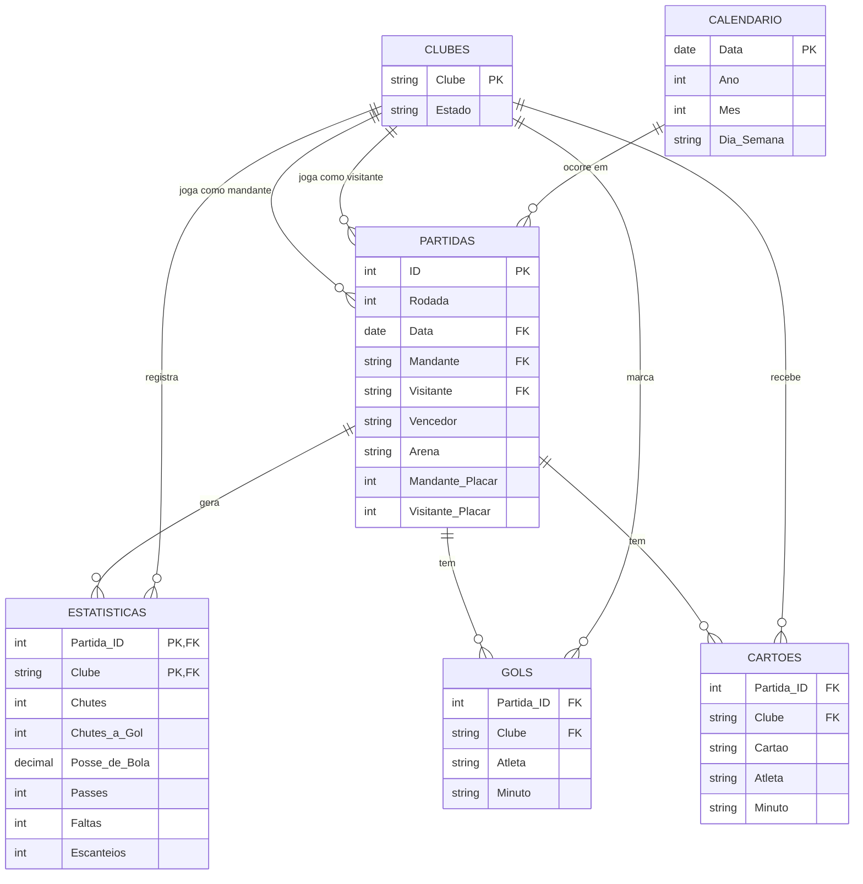

# ⚽ Brasileirão BI — Campeonato Brasileiro Série A (2003–2024)

Dashboard em **Power BI** com a análise histórica do Campeonato Brasileiro Série A, de 2003 a 2024: partidas, gols, cartões e estatísticas dos clubes.

> **Prova — Software Product: Analysis, Specification, Project & Implementation**
> ADS 5A · EAD · Faculdade Impacta
> Autor: **Matheus**

---

## 📌 Links da entrega

| Item | Link |
|---|---|
| 🎥 Vídeo de apresentação | https://1drv.ms/v/c/b39d037059406687/IQDhDaCjEPDrRKjGHmX8mzCHAchTYu0C2iqLw03ORmJ97e0?e=KvY0rD |
| 📋 Board do projeto | https://github.com/users/mathe1462/projects/4 |
| 💻 Código-fonte | https://github.com/mathe1462/Brasileirao-PowerBI |

---

## 📊 Fonte de dados

**Brasileirão Dataset** — [adaoduque/Brasileirao_Dataset](https://github.com/adaoduque/Brasileirao_Dataset)

| Arquivo | Conteúdo |
|---|---|
| `campeonato-brasileiro-full.csv` | Uma linha por partida: rodada, data, mandante, visitante, placar, arena, técnicos e formações |
| `campeonato-brasileiro-estatisticas-full.csv` | Estatísticas de cada clube por partida: chutes, posse, passes, faltas, escanteios |
| `campeonato-brasileiro-gols.csv` | Um registro por gol: atleta, clube e minuto |
| `campeonato-brasileiro-cartoes.csv` | Um registro por cartão: atleta, cor, posição e minuto |

---

## 🗂️ Modelo de dados — MER




### Entidades e relacionamentos

- **PARTIDAS** é a tabela central (fato): cada linha é um jogo, identificado pelo `ID`.
- **CLUBES** (dimensão): criada no Power Query a partir de Mandante e Visitante. Liga-se a PARTIDAS **duas vezes**, como mandante e como visitante.
- **CALENDARIO** (dimensão): criada a partir da coluna Data. Permite filtrar por ano e mês.
- **ESTATISTICAS**, **GOLS** e **CARTOES** são detalhes da partida (`Partida_ID` → `PARTIDAS.ID`) e do clube (`Clube` → `CLUBES.Clube`).
- Todos os relacionamentos são **1:N**. ESTATISTICAS tem chave composta (`Partida_ID` + `Clube`), porque cada partida tem uma linha por time.

---

## 🛠️ Tecnologias

- Power BI Desktop (Power Query + DAX)
- GitHub (repositório e GitHub Projects)
- Mermaid (diagrama MER)

---

## 📁 Estrutura do repositório

```
Brasileirao-PowerBI/
├── README.md
├── dados/        # CSVs do dataset
├── docs/         # MER (PNG e Mermaid)
└── powerbi/      # arquivo .pbix e medidas DAX
```

---

## ✅ Status

- [x] Dataset baixado
- [x] MER criado
- [ ] Tratamento no Power Query
- [ ] Medidas DAX
- [ ] Dashboard
- [ ] Vídeo de apresentação
